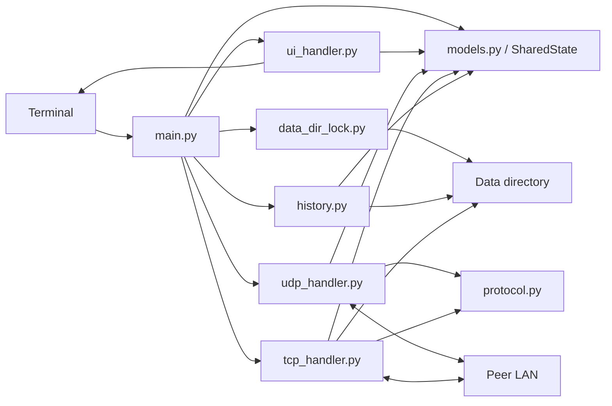
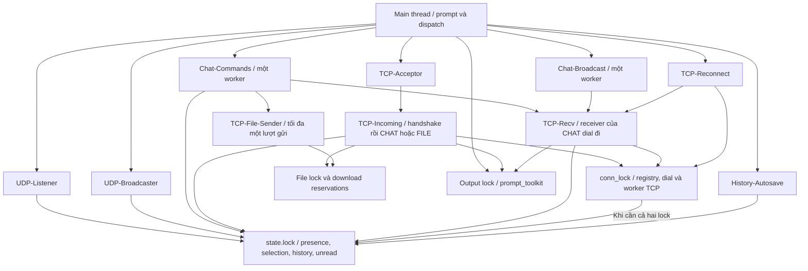
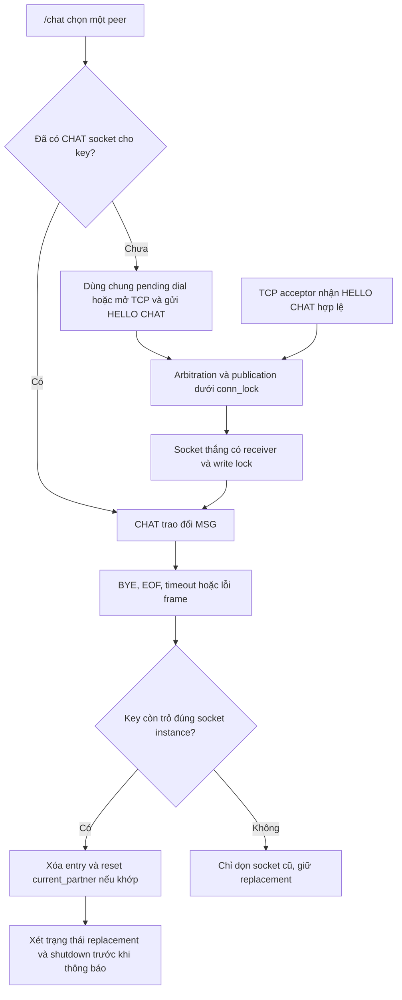
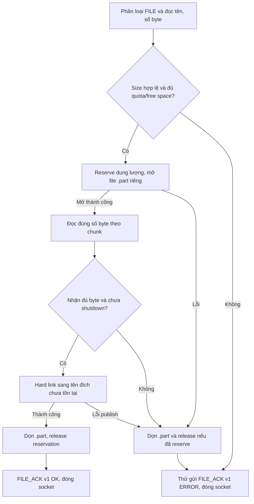

# Kiến trúc và luồng thực thi

[README](../README.md) · [Giao thức](PROTOCOL.md) · [Kiểm thử](TESTING.md) · [Bảo mật](SECURITY.md)

## Thành phần

Mỗi instance vừa nghe trên UDP/TCP vừa có thể chủ động mở kết nối TCP. Không có server điều phối trung tâm.

| Module | Trách nhiệm |
|---|---|
| [main.py](../main.py) | Phân tích tham số, thiết lập console, startup/shutdown, dispatch lệnh, chat/broadcast queue và callback sang UI. |
| [models.py](../models.py) | `SharedState`, `Peer`, `ChatConnection`, presence, alias theo endpoint, selection, history, unread và registry TCP. |
| [protocol.py](../protocol.py) | Hằng số và encode/decode frame. TCP handler thực thi các vòng đọc/ghi theo độ dài và deadline. |
| [udp_handler.py](../udp_handler.py) | Broadcast HELLO2/HELLO, nhận presence, bỏ gói của chính mình, cập nhật peer và quét expiry. |
| [tcp_handler.py](../tcp_handler.py) | Acceptor, handshake, dial và arbitration, CHAT receiver/writer, reconnect, FILE sender/receiver và quota. |
| [ui_handler.py](../ui_handler.py) | `PromptSession`, completion, prompt theo selection, render history và đồng bộ output. |
| [history.py](../history.py) | Nạp JSON, tạo snapshot history, autosave và lần lưu cuối. |
| [data_dir_lock.py](../data_dir_lock.py) | Lấy khóa độc quyền không chờ trên `.lan-chat.lock` và giữ descriptor đến khi process kết thúc. |

## Startup và discovery

Main xác minh tham số và kích thước gói discovery trước khi mở network service. Sau khi tạo console và resolve/tạo data directory, nó lấy khóa OS, rồi đọc history. Trình tự khởi động là TCP listener và reconnect worker, UDP listener/broadcaster, history autosave, các command worker, rồi vòng đọc prompt. Nếu TCP không khởi động được, app trả mã `1` trước khi bắt đầu quảng bá. Lỗi khởi động UDP có thông báo; ứng dụng tiếp tục hoạt động với những thành phần đã khởi động.

Trên POSIX, khóa dùng `flock`; trên Windows, dùng `msvcrt.locking`. File lock tồn tại sau khi thoát và OS giải phóng khóa khi process kết thúc. Dùng một data directory cho mỗi instance. Khóa không chặn công cụ khác ghi file trực tiếp và không phối hợp với phiên bản cũ không dùng lock này.

Broadcaster phát `HELLO2` và `HELLO` mỗi 3 giây. Listener lấy source IPv4 và TCP port quảng bá, cập nhật thời điểm thấy peer bằng monotonic clock, và thông báo khi peer xuất hiện hoặc hết hạn. Ngưỡng hết hạn là 10 giây kể từ presence cuối, thực thi qua lượt quét định kỳ. Hết hạn xóa presence và selection/reconnect tương ứng; expiry không chủ động đóng TCP socket. Alias của HELLO2 phục vụ việc gộp endpoint trong phiên, với giới hạn [6A-03](SECURITY.md#6a-03-endpoint-alias).

## Threads, queue và shared state

- Main xử lý prompt, `/list`, `/status`, `/help` và `/quit`. Chat worker chạy các lệnh chọn peer, gửi text, yêu cầu file sender, đọc history và rời hội thoại. Broadcast có FIFO worker riêng; nội dung broadcast đi qua TCP đến từng peer của snapshot.
- Chat queue giữ tối đa **64 lệnh chờ và 32 MiB payload**. Broadcast queue giữ tối đa **8 lệnh chờ và 16 MiB payload**. Budget tính cả payload đã lấy ra đang chạy. Lệnh bị từ chối khi hết slot hoặc budget. RAM của process còn có history, draft, network buffers và Python overhead.
- Acceptor tạo worker trên mỗi socket đến. Một worker đã nhận tiếp tục đọc CHAT hoặc nhận một FILE sau khi phân loại handshake. Giới hạn **32 inbound workers** dùng chung cho các nhánh này; receiver của outbound CHAT nằm ngoài giới hạn đó. File sender dùng kết nối riêng, chỉ có một lượt chạy mỗi process.
- `state.lock` bảo vệ thay đổi peer list, selection, history và unread. Broadcaster đọc tên/port đã khởi tạo và snapshot giá trị status; listener ghi presence qua `SharedState`. `conn_lock` bảo vệ registry, pending dials và đăng ký worker TCP. Đường cập nhật cần cả hai lấy `conn_lock` trước `state.lock`.
- Mỗi `ChatConnection` có write lock để frame không ghi xen byte. Kiểm tra socket owner diễn ra trước khi gửi, sau đó trả registry lock. Kết thúc socket, chờ pending dial, join và callback UI diễn ra ngoài registry lock. Download lock bảo vệ quét quota, reserve, publish và release. File-sender lock giữ tham chiếu tới worker/socket đang gửi. Output lock tuần tự hóa phần in và `patch_stdout()` phối hợp redraw với prompt.

## Vòng đời TCP và selection

Khi hai đầu cùng dial, mỗi đầu ưu tiên stream do endpoint lắng nghe nhỏ hơn khởi tạo, so sánh tuple IPv4 và TCP port. Registry lock kiểm soát thay thế. Receiver cũ giữ socket instance của chính nó; EOF của socket cũ không được xóa entry của socket mới. Nếu thông báo lỗi trong giai đoạn sau publication và trước khi receiver bắt đầu, nhánh handoff dọn socket đã đăng ký theo cùng quy tắc ownership.

Chat queue gắn text, `/send` và `/file` với future của lần chọn gần nhất. Worker xóa selection cũ trước khi thử kết nối mới. Nếu lần chọn thất bại, các lệnh gửi liên quan bị chặn, kể cả lệnh đến sau thông báo lỗi. Từ chối `/chat` khi queue đầy cũng làm mất hiệu lực kết quả kết nối cũ đến muộn. Người dùng có thể chọn lại hoặc dùng `/leave` để về trạng thái chưa chọn peer. Kết quả giải quyết theo thứ tự FIFO, không tự phát lại lệnh đã từ chối.

Receiver ghi history và chụp unread count cùng lúc dưới `state.lock`. Snapshot được chuyển cho UI để render ngoài lock. Khi mở hội thoại, UI lấy cửa sổ history cần hiển thị, mở rộng nếu có unread cũ hơn, rồi trừ số unread đã hiển thị mà vẫn giữ cập nhật đến trong lúc render.

Reconnect worker kiểm tra theo nhịp 15 giây. Chỉ thử lại khi selection phục hồi còn hiệu lực và peer vẫn có presence. Khi dial hoàn tất, app kiểm tra lại state trước khi phục hồi selection. `/leave` xóa current/reconnect selection và giữ socket TCP; BYE/EOF thực sự kết thúc stream. Xem [ngữ nghĩa disconnect](PROTOCOL.md#bye-eof-và-đóng-kết-nối).

## File transfer và publication

Sender xác minh file thường, giới hạn kích thước và khả năng encode header trước khi mở socket transfer. Receiver reserve byte theo kích thước khai báo, so với file thường đang có và dung lượng trống. Reservation tính phần chưa ghi của transfer đang chạy. Temp file và tên cuối nằm trên cùng filesystem. `os.link` publish tên mới; nếu tên đã tồn tại, receiver thử tên có hậu tố. Dọn temp hoặc log lỗi dọn và giải phóng reservation. Frame thiếu hoặc lỗi publication không trả ACK thành công. Chi tiết framing, timeout và ý nghĩa ACK nằm trong [PROTOCOL.md](PROTOCOL.md).

Trên Windows, tên đích sau chuẩn hóa vẫn có thể chịu cách diễn giải riêng của filesystem. Tên đặc biệt có thể được lưu dưới dạng khó thao tác hoặc thay đổi khi publish. **6D05-F01: RISK ACCEPTED — NOT FIXED.** Phạm vi sử dụng là peer tin cậy và tên file thông thường. [Giới hạn tên file Windows](SECURITY.md#6d-05-giới-hạn-tên-file-windows)

## History và shutdown

`chat_history.json` lưu map từ peer key tới danh sách chuỗi. Unread count chỉ ở RAM. Autosave dùng một writer, thông thường mỗi 60 giây. Writer chụp snapshot dưới lock, ghi JSON UTF-8 vào temp file cùng thư mục rồi `os.replace`. Khi không load được JSON hoặc sai cấu trúc thông thường, app giữ file cũ và vô hiệu hóa ghi đè. Giới hạn khác của phục hồi và độ bền nằm trong [SECURITY.md](SECURITY.md).

`/quit`, EOF tại prompt và `Ctrl+C` trong vòng lặp đi qua shutdown chung. Main đặt stop event, hủy lệnh chưa chạy, đánh thức pending dial/receiver và đóng các CHAT socket. File sender và TCP workers nhận yêu cầu dừng; main chờ chúng và các thread đã đăng ký trong ngân sách khoảng 2 giây. Sau đó main chờ tối đa 2 giây cho final history save. Nếu còn worker hoặc save chưa xong, app báo cảnh báo. Khóa data directory được giữ tới lúc process chấm dứt, kể cả khi một worker chưa hoàn thành trong ngân sách chờ.
