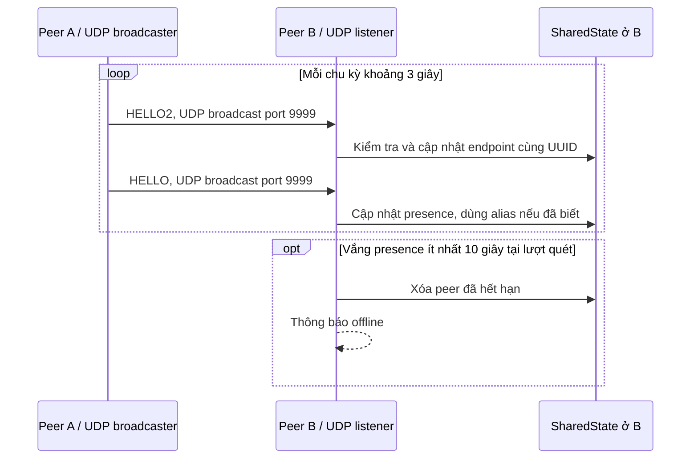
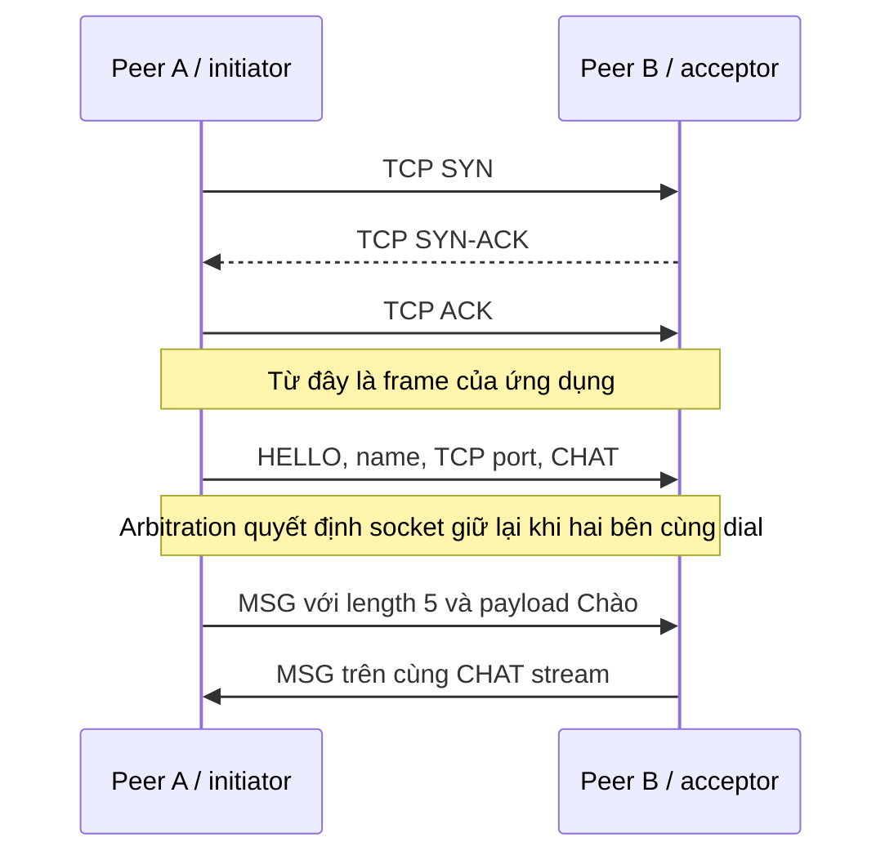
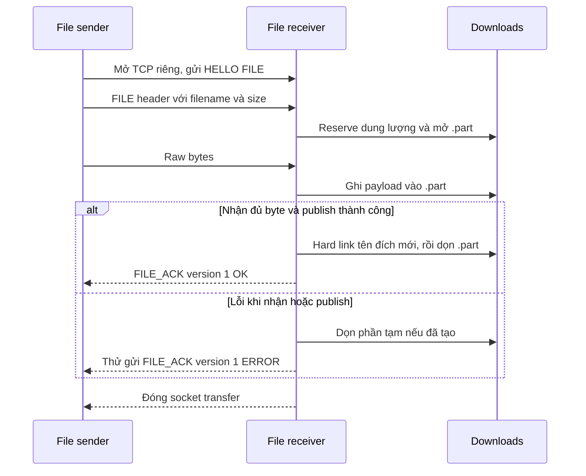
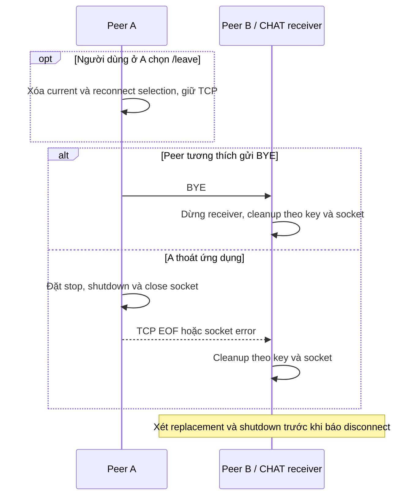

# Giao thức UDP và TCP

[README](../README.md) · [Kiến trúc](ARCHITECTURE.md) · [Kiểm thử](TESTING.md) · [Bảo mật](SECURITY.md)

Các ví dụ dưới đây dùng tên và payload tổng hợp. Ký tự phân cách là `|` (ASCII `0x7C`). Gói UDP là một datagram. TCP là byte stream; một frame có thể nằm trong nhiều packet và một lần đọc không được giả định là đủ dữ liệu.

## UDP discovery

| Định dạng | Chiều | Trường |
|---|---|---|
| `HELLO\|<name>\|<tcp_port>\|<status>` | Peer → broadcast UDP `9999` | Tên, TCP port lắng nghe, trạng thái. |
| `HELLO2\|<name>\|<tcp_port>\|<status>\|<instance_id>` | Peer → broadcast UDP `9999` | Cùng các trường trên và UUID của instance. |

Encoder dùng UTF‑8, phát `HELLO2` rồi `HELLO` mỗi 3 giây cho từng địa chỉ đích. Không có dấu `|` cuối gói. Production gửi broadcast LAN và có thêm đích loopback broadcast `127.255.255.255`. UDP sender dùng source port riêng; TCP port được quảng bá là giá trị trong payload. UUID mới được tạo khi khởi động và encode dưới dạng 32 ký tự hex. Tên local bỏ khoảng trắng đầu/cuối, đổi `|` thành `_` và dùng `Anonymous` nếu rỗng.

```text
HELLO|QA-A|5001|available
HELLO2|QA-A|5001|available|0123456789abcdef0123456789abcdef
```

Decoder từ chối datagram lớn hơn **2.048 byte**, UTF‑8 lỗi, sai loại/số trường, TCP port ngoài `1–65535` hoặc UUID không parse được. Field status được trim và chuyển lowercase. Các giá trị wire nhận biết là `available`, `away`, `busy`; giá trị khác được quy về `available`. CLI ánh xạ `online` thành `available`. Startup xác minh tên với cả hai kiểu gói và mọi status được hỗ trợ. Endpoint dùng source IPv4 thực tế và port quảng bá. Cặp HELLO2/HELLO duy trì khả năng discovery với phiên bản chỉ hiểu HELLO; UUID phục vụ gộp endpoint và lọc gói tự gửi, không xác thực peer.


Tham chiếu triển khai ở [protocol.py](../protocol.py) và [udp_handler.py](../udp_handler.py).

## TCP handshake và CHAT

TCP listener bind trên port do `--port` chọn. OS thực hiện TCP three-way handshake **trước** khi app gửi HELLO. Sau khi connect, bên chủ động gửi:

```text
HELLO|<name>|<tcp_port>|CHAT|
HELLO|<name>|<tcp_port>|FILE|
```

Các trường header là UTF‑8 strict khi đọc; mỗi trường tối đa **4.096 byte**. Dấu `|` cuối kết thúc trường `CHAT` hoặc `FILE`. Bên nhận kiểm tra TCP port và loại kết nối trong deadline handshake chung **10 giây** tính từ khi worker bắt đầu đọc. Deadline này cũng bao gồm header FILE nếu loại kết nối là FILE. Không có application-level ACK riêng cho HELLO CHAT. Bên nhận lấy endpoint từ địa chỉ TCP nguồn và port khai báo, tra alias nếu có rồi dùng arbitration trước khi giữ socket. Header sai, quá deadline hoặc kiểu kết nối lạ làm đóng socket đó.

Hai bên trên CHAT socket có thể gửi nhiều `MSG`:

```text
MSG|<length>|<UTF-8 bytes>
MSG|5|Chào
```

`Chào` có 4 ký tự nhưng 5 byte UTF‑8. `length` là số byte từ **0 đến 10 MiB**. Không thêm delimiter sau payload; ký tự `|` trong payload chỉ là dữ liệu. Receiver đọc đúng số byte trước khi xử lý frame tiếp. Header lỗi UTF‑8 bị từ chối. Byte UTF‑8 lỗi trong payload được decode với ký tự thay thế. Payload thiếu không được ghi vào history/unread. Khi frame sai, EOF hoặc hết deadline, receiver dọn connection theo socket owner.

| Giai đoạn CHAT | Ngưỡng |
|---|---|
| Outbound TCP connect | **5 giây**. `sendall()` của HELLO dùng socket timeout đã đặt sau connect. |
| Chờ byte đầu frame kế tiếp | Có thể idle. |
| Đọc type và length | **10 giây** từ byte đầu cho toàn bộ header. |
| Nhận payload | **10 giây** không tiến triển và **60 giây** tổng thời gian nhận payload. |
| Ghi một frame MSG | **10 giây** tính từ lúc phía gửi bắt đầu chờ write lock, dùng phần còn lại cho các partial writes sau khi lấy được lock. |



## FILE và FILE_ACK

Mỗi lượt gửi dùng TCP connection riêng. Sau `HELLO|<name>|<tcp_port>|FILE|`, sender gửi `FILE|<filename>|<size>|<raw bytes>`. Receiver cũng hiểu dạng tương thích bắt đầu ngay bằng `FILE|` trên kết nối mới. Dạng trực tiếp vẫn qua cùng kiểm tra kích thước/quota. FILE payload là byte thô; `size` là số byte từ **0 đến 2 GiB**. Encoder dùng basename local, đổi ký tự `|` thành `_`, bỏ khoảng trắng đầu/cuối và thay tên rỗng bằng `unnamed_file`. Header dùng UTF‑8 strict và được encode trước khi mở socket. Receiver chuẩn hóa tên theo filesystem local và dùng `downloaded_file` khi tên rỗng, `.` hoặc `..`.

```text
HELLO|QA-A|5001|FILE|
FILE|demo.txt|3|abc
FILE_ACK|1|OK|
```

Ba dòng minh họa thứ tự logic. Trên wire, HELLO nối liền FILE không có newline, và ACK đi **chiều ngược lại**. Receiver đọc đúng `size` byte, ghi `.part`, rồi publish tên đích bằng hard link. Nếu trùng tên, receiver chọn hậu tố. Nếu file chưa publish được do quota, EOF hoặc lỗi I/O, receiver dọn phần tạm và thử báo lỗi. Header bị từ chối trước khi vào file receiver có thể chỉ dẫn đến socket đóng.

`FILE_ACK|1|<status>|` do receiver gửi, gồm ASCII cho loại, version và status. Sender đọc theo cùng field delimiter, với deadline **10 giây** cho toàn bộ ACK.

| Wire ACK | Kết quả sender |
|---|---|
| `FILE_ACK\|1\|OK\|` | `SAVED`, receiver báo đã publish file. |
| `FILE_ACK\|1\|ERROR\|` | `FAILED`, receiver báo không lưu. |
| Thiếu, lỗi parse, type/version/status không hỗ trợ hoặc hết thời gian | `UNCONFIRMED` sau khi sender gửi dữ liệu. File vẫn có thể đã được lưu tại receiver. |
| Lỗi mở nguồn, encode header, kết nối hoặc ghi payload | `FAILED` từ phía sender. |

FILE connect và socket I/O dùng timeout **10 giây**. Các lần gửi/đọc payload có ngưỡng theo thao tác, không có deadline tổng cho transfer. `FILE_ACK` báo kết quả publish do receiver cung cấp. Giao thức không gửi SHA-256, không xác thực lời báo của receiver và không bảo đảm dữ liệu đã bền qua mất điện. Muốn xác nhận nội dung khớp, tính SHA-256 riêng trên file nguồn và file đích rồi đối chiếu. Tên đích trên Windows có giới hạn đã được chấp nhận theo [6D-05](SECURITY.md#6d-05-giới-hạn-tên-file-windows).



## BYE, EOF và đóng kết nối

- `BYE|` là frame CHAT được nhận biết, không có length hoặc payload. Receiver dừng đọc và dọn socket. Nếu đúng owner, receiver bỏ current selection tương ứng. Thông báo chỉ phát khi registry vẫn chưa có replacement tại lúc kiểm tra và app chưa shutdown.
- EOF, peer reset hoặc lỗi đọc cũng kết thúc receiver. EOF giữa frame không tạo tin nhắn. Cleanup kiểm tra **key và socket instance** để socket cũ không xóa replacement.
- **`/leave`** bỏ current/reconnect selection ở máy local. App giữ TCP connection để tái sử dụng; lệnh này không gửi BYE. Tin đến từ peer cũ khi chưa chọn hội thoại được lưu và báo unread.
- **`/quit` và `Ctrl+C` tại prompt** đặt stop event, shutdown/close các socket và chờ worker theo ngân sách. App không phát BYE tự động khi thoát. Đầu xa có thể quan sát EOF hoặc socket error từ lớp TCP.
- Sau BYE/EOF, auto-reconnect vẫn có thể phục hồi peer đã chọn nếu reconnect selection còn hiệu lực và UDP presence còn mới. `/leave`, selection mới hoặc peer timeout làm mất mục tiêu reconnect cũ theo state hiện tại.



Tham chiếu triển khai ở [tcp_handler.py](../tcp_handler.py), [protocol.py](../protocol.py) và [main.py](../main.py).
