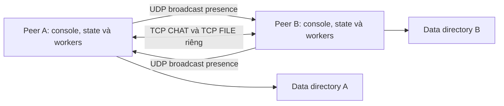
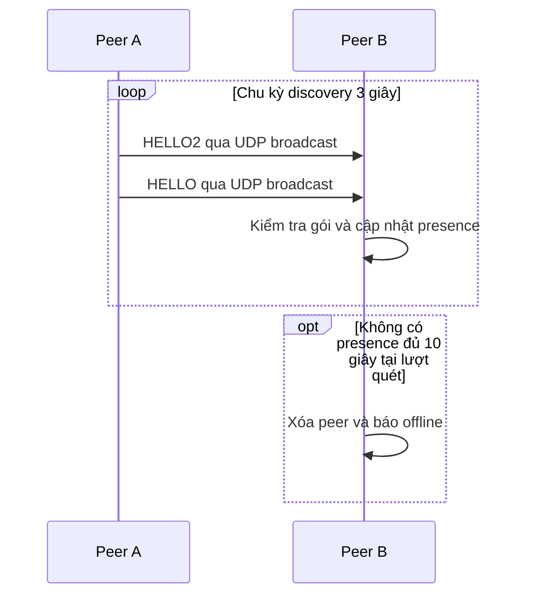
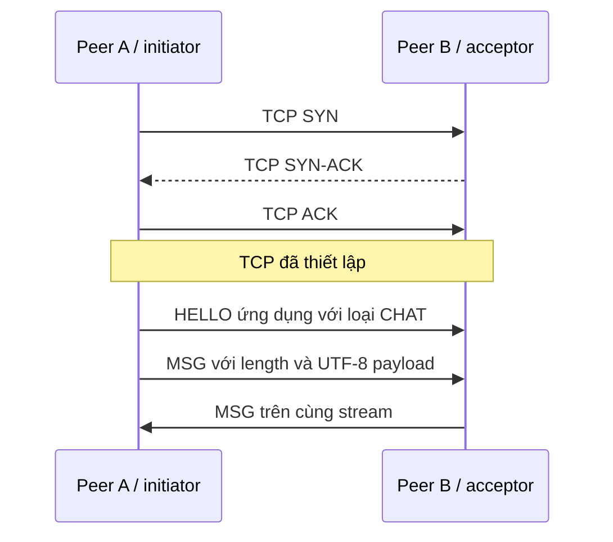
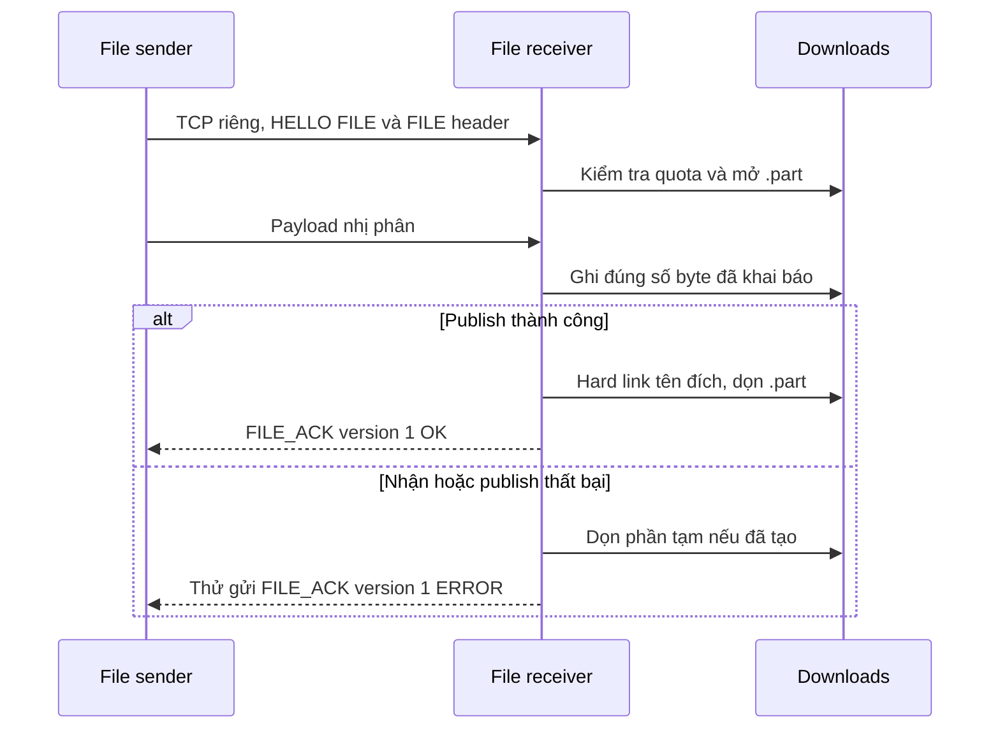

# Báo cáo đồ án lập trình socket

| Thông tin | Giá trị |
|---|---|
| Đề tài | LAN Chat & File Sharing (Command-Line) |
| Dự án | `lan_chat` |
| Trường | [Điền tên trường] |
| Khoa | [Điền tên khoa] |
| Học phần | Mạng máy tính [Xác nhận tên và mã học phần chính thức] |
| Giảng viên | [Điền họ tên giảng viên] |
| Ngày nộp | [Điền ngày nộp] |

| Thành viên | Mã số sinh viên |
|---|---|
| [Họ tên thành viên 1] | [MSSV 1] |
| [Họ tên thành viên 2] | [MSSV 2] |
| [Thành viên 3, nếu có] | [MSSV 3, nếu có] |

*Bản thảo kỹ thuật cho baseline Phase 6H.2A. Final QA: ACCEPT WITH DOCUMENTED LIMITATIONS. Thông tin bìa, ảnh Wireshark đã duyệt và PDF cuối sẽ được hoàn thiện ở giai đoạn Final Technical Report.*

---

## 1. Giới thiệu và mục tiêu

Đề bài yêu cầu xây dựng ứng dụng chat và chia sẻ file trên LAN bằng Socket API của ngôn ngữ lập trình. Các mục tiêu gồm sử dụng UDP broadcast, nhận biết ranh giới thông điệp trên TCP byte stream, phục vụ nhiều kết nối đồng thời, duy trì dòng nhập khi tin đến, và xử lý disconnect, timeout hoặc dữ liệu nhận dở. Báo cáo này mô tả giải pháp Python với giao diện console. [1]

Mỗi peer chạy cùng một chương trình, vừa lắng nghe vừa có thể chủ động kết nối. Không có server trung tâm. UDP dùng cho discovery và trạng thái vì presence được gửi lại định kỳ, nên việc mất một datagram không làm gián đoạn luồng chat. TCP cung cấp byte stream có thứ tự cho tin nhắn và file. Ứng dụng tự chia frame và kiểm tra số byte thực nhận.

Phạm vi là LAN IPv4 tin cậy, với **một endpoint ổn định được quan sát cho mỗi peer**. Các chức năng theo đề gồm discovery, danh sách online/away, chọn đối tác theo tên hoặc số, chat hai chiều, unread, truyền file có tiến độ, console không mất draft và xử lý lỗi. Những cải tiến độ tin cậy của dự án gồm history lưu qua các phiên, reconnect có điều kiện, queue có ngân sách payload, quota downloads và khóa data directory. `/broadcast` là lệnh mở rộng của ứng dụng. [1–4]

## 2. Kiến trúc hệ thống

**Hình 1. Hai peer chạy cùng kiến trúc, mỗi peer sở hữu một data directory.**



| Module | Trách nhiệm |
|---|---|
| [main.py](../main.py) | Kiểm tra tham số, khởi động, đọc prompt, dispatch lệnh, điều phối chat/broadcast queue và shutdown. |
| [models.py](../models.py) | Giữ peer table, endpoint alias, selection, unread, history và registry TCP trong `SharedState`. |
| [protocol.py](../protocol.py) | Khai báo wire format, giới hạn và hàm encode/decode. |
| [udp_handler.py](../udp_handler.py) | Phát presence, nhận và parse datagram, cập nhật peer và quét hết hạn. |
| [tcp_handler.py](../tcp_handler.py) | Accept/dial, phân loại socket, arbitration, đọc/ghi CHAT, truyền FILE, quota và reconnect. |
| [ui_handler.py](../ui_handler.py) | `PromptSession`, completion, đồng bộ output và render history. |
| [history.py](../history.py) | Đọc JSON, chụp snapshot, lưu định kỳ và lưu khi thoát. |
| [data_dir_lock.py](../data_dir_lock.py) | Lấy khóa OS không chờ trên `.lan-chat.lock`, giữ descriptor đến lúc process kết thúc. |

**Khởi động.** Main kiểm tra tham số và kích thước tên discovery, thiết lập console, resolve data directory, lấy khóa rồi nạp history. Sau khi TCP listener khởi động thành công, app khởi động các luồng UDP, history autosave và các command worker trước khi đọc prompt. Khóa `flock` trên POSIX hoặc `msvcrt.locking` trên Windows bảo vệ thư mục giữa các instance hợp tác. Mỗi instance dùng data directory riêng. [3]

| Luồng hoặc nhóm worker | Công việc và vòng đời |
|---|---|
| Main, Chat-Commands và Chat-Broadcast | Main đọc phím và xử lý lệnh nhanh. Hai FIFO worker xử lý chat/file command và broadcast riêng, giúp prompt phản hồi khi network I/O chậm. |
| UDP broadcaster, UDP listener | Cùng sống theo process; broadcaster gửi định kỳ, listener cập nhật presence và expiry. |
| TCP acceptor và workers | Acceptor tạo worker cho socket đến, worker phân loại rồi đọc CHAT hoặc nhận một FILE. CHAT dial đi có receiver riêng. |
| File sender, reconnect, autosave | File sender hoạt động trên socket riêng cho một lượt gửi. Reconnect kiểm tra định kỳ sự lựa chọn còn hiệu lực. Autosave dùng một writer cho cả lưu định kỳ và lần lưu cuối. |

`state.lock` bảo vệ presence, selection, history và unread; `conn_lock` bảo vệ registry, pending dial và worker TCP. Khi cần cả hai, code lấy **`conn_lock → state.lock`**. Mỗi CHAT connection có write lock để frame không ghi xen byte. Callback UI, shutdown socket và join được thực hiện ngoài registry lock. Output lock tuần tự hóa phần in, còn `prompt_toolkit` phối hợp redraw. [3]

## 3. Thiết kế giao thức mạng

### 3.1 UDP discovery

Một UDP datagram giữ ranh giới riêng. Mỗi instance phát `HELLO2` rồi `HELLO` theo chu kỳ **3 giây**, dùng cổng đích UDP **9999**. Receiver dùng source IPv4 thực tế và TCP port quảng bá để nhận diện endpoint. `HELLO2` mang UUID của instance để hỗ trợ gộp endpoint; `HELLO` giữ khả năng discovery với peer chỉ hiểu định dạng cũ. UUID được tạo lại ở lần khởi động và không xác thực người dùng. Hai định dạng không có delimiter cuối. [4]

```text
HELLO|<name>|<tcp_port>|<status>
HELLO2|<name>|<tcp_port>|<status>|<instance_id>
HELLO|QA-A|5001|available
HELLO2|QA-A|5001|available|0123456789abcdef0123456789abcdef
```

Datagram lớn hơn **2.048 byte**, UTF-8 lỗi, port ngoài **1–65535**, trường sai kiểu hoặc UUID không parse được bị loại. Status gồm `available`, `away`, `busy`; giá trị lạ được quy về `available`. CLI `online` ánh xạ thành `available`. Ngưỡng expiry là **10 giây** từ presence cuối, áp dụng tại lượt quét. [4]

**Hình 2. Discovery và cập nhật presence ở đầu nhận.**



### 3.2 TCP CHAT

Hệ điều hành thực hiện **SYN, SYN-ACK, ACK** để thiết lập TCP. Sau đó bên dial mới gửi HELLO **cấp ứng dụng** khai báo tên, TCP port lắng nghe và loại kết nối. CHAT không có application-level ACK riêng cho HELLO. Trường header dùng UTF-8 strict khi đọc, giới hạn **4.096 byte/trường**. Worker đọc phần bắt tay trong deadline chung trước khi giữ socket. [4]

```text
HELLO|<name>|<tcp_port>|CHAT|
HELLO|QA-A|5001|CHAT|
MSG|<length>|<UTF-8 bytes>
MSG|5|Chào
BYE|
```

`length` là số byte từ **0 đến 10 MiB**. Ví dụ `Chào` có bốn ký tự và **năm byte UTF-8**. Không thêm dấu phân cách sau payload; phía nhận lặp `recv()` đến đủ số byte. Payload UTF-8 lỗi được giải mã bằng ký tự thay thế. Frame bị ngắt giữa chừng không cập nhật history/unread. `BYE|` là frame kết thúc mà receiver nhận biết, không có payload. [4]

**Hình 3. Bắt tay TCP, HELLO và trao đổi tin trên cùng stream.**



### 3.3 TCP FILE và xác nhận

Mỗi transfer mở một TCP connection riêng, gửi HELLO loại FILE rồi gửi header quy định số byte thô của file. Receiver cũng chấp nhận frame bắt đầu bằng FILE trên một socket mới vì tương thích; đường này vẫn kiểm tra kích thước và quota. Trong ví dụ, HELLO và FILE nối tiếp trên wire. ACK đi chiều ngược lại. [4]

```text
HELLO|<name>|<tcp_port>|FILE|
FILE|<filename>|<size>|<raw bytes>
FILE_ACK|1|<OK hoặc ERROR>|
```

Ví dụ: `HELLO|QA-A|5001|FILE|`, tiếp theo là `FILE|demo.txt|3|abc`. Khi receiver publish thành công, nó gửi `FILE_ACK|1|OK|`. Sender báo `SAVED` với ACK đó, `FAILED` khi receiver trả `ERROR` hoặc sender gặp lỗi nguồn/kết nối/gửi. Nếu dữ liệu đã gửi nhưng ACK thiếu, lỗi hoặc version/status không được hỗ trợ, kết quả là `UNCONFIRMED`. [4]

**Hình 4. File đi trên socket riêng; ACK phản ánh kết quả publication.**



## 4. Thực hiện chức năng

**Presence và danh sách.** `/list` hiện số thứ tự, tên, IPv4/TCP port, status và badge kết nối hoặc unread khi có. Peer thấy thay đổi `/status away` hoặc `/status online` qua discovery. `/chat` nhận tên hoặc số từ snapshot `/list` gần nhất. Nếu tên trùng, người dùng có thể chọn bằng số. [2–3]

**Chat và sai khác thời điểm.** Registry tái sử dụng socket đang có. Khi cả hai đầu cùng dial, mỗi đầu ưu tiên stream do endpoint lắng nghe nhỏ hơn khởi tạo, so sánh tuple IPv4 và TCP port. Khi socket cũ kết thúc, cleanup chỉ xóa registry nếu key và socket instance vẫn khớp. Chat worker ghi kết quả mỗi lần chọn vào một future. Tin và lệnh gửi file liên quan đến lần chọn bị lỗi sẽ bị chặn, tránh rơi về đối tác cũ hoặc tự phát lại sau khi chọn lại. [3]

**Unread và console.** Receiver ghi tin và chụp unread counter của đúng peer dưới cùng lock. UI render snapshot ngoài lock, hiện trực tiếp số tin chưa đọc. Khi mở hội thoại, app hiện các tin chưa đọc và cập nhật counter; tin từ hội thoại đang chọn được hiển thị trực tiếp. History có thể lưu qua các phiên, còn unread counter chỉ ở RAM. `PromptSession`, `patch_stdout()` và output lock giúp giữ draft và cursor khi tin, progress hoặc thông báo nền xuất hiện. `/broadcast` dùng worker riêng để gửi qua TCP tới từng peer trong snapshot danh sách online. [2–3]

**File và kết thúc chat.** `/send` và alias `/file` gửi file thường cho peer đang chọn, hiện phần trăm tiến độ và vẫn cho phép chat. Receiver lưu vào `downloads/` thuộc data directory. `/leave` chỉ xóa selection và mục tiêu reconnect, giữ TCP để lần chọn tiếp theo có thể dùng lại và tin đến vẫn được lưu như unread. Nếu nhận `BYE|`, EOF hoặc socket error, receiver dọn socket theo ownership và báo ngắt khi phù hợp. `/quit` đóng socket qua shutdown chung; ứng dụng không tự gửi BYE khi thoát. Reconnect chỉ thử khi mục tiêu còn hiệu lực và presence còn mới, theo nhịp **15 giây**. Lệnh `/help` liệt kê cách sử dụng; lệnh sai nhận thông báo hướng dẫn. [2–4]

## 5. Xử lý lỗi, độ tin cậy và bảo mật

| Cơ chế | Giá trị và phạm vi |
|---|---|
| TCP handshake đến | **10 giây** cho các trường handshake, gồm phần header FILE khi có. Giới hạn **4.096 byte/trường**. |
| CHAT | Connect **5 giây**; ghi một MSG **10 giây** tính từ lúc bắt đầu chờ write lock. Header nhận **10 giây** kể từ byte đầu. Payload nhận tối đa **10 giây không tiến triển** và **60 giây tổng**, với giới hạn **10 MiB**. |
| FILE và FILE_ACK | **2 GiB/file**, chunk **64 KiB**, connect và socket I/O dùng timeout **10 giây**. FILE không có deadline tổng payload. ACK có deadline riêng **10 giây** kể từ lúc sender chờ ACK. |
| Worker và queue | Tối đa **32 inbound workers** dùng chung cho handshake/CHAT/FILE. Chat queue có **64 lệnh chờ, 32 MiB payload**; broadcast queue có **8 lệnh chờ, 16 MiB payload**. Budget tính cả job đang chạy. |
| Storage | Receiver reserve byte trước khi tạo `.part`, xét quota downloads mặc định **8 GiB** và free space. Một file sender tại một thời điểm trong mỗi process. |
| Shutdown và history | Autosave theo khoảng chờ **60 giây**. Shutdown hủy lệnh chờ, đóng socket, chờ workers với ngân sách **2 giây**, rồi chờ final history save tối đa **2 giây**. |

Các giới hạn trên áp dụng tại từng tầng. CHAT có thể chờ byte đầu của frame kế tiếp trong khi socket idle. Cap inbound không giới hạn tổng số socket, còn queue budget chỉ tính payload. Peer table trong cửa sổ presence, history và tổng mức RAM vẫn không có cap ứng dụng. Quota byte downloads cũng không giới hạn số file nhỏ. Hai ngân sách chờ shutdown không tạo deadline cứng cho toàn process khi filesystem hoặc output chậm. [5]

| Khó khăn | Giải pháp và phần còn lại |
|---|---|
| EOF, partial frame và ghi đồng thời | Đọc đủ số byte, từ chối malformed frame, giữ deadline theo monotonic clock và tuần tự hóa write trên từng CHAT socket. Cleanup theo socket owner để bảo toàn replacement. |
| Transfer gián đoạn và trùng tên | Ghi `.part` riêng, dọn file dở và giải phóng reservation. Hard link cùng filesystem publish tên mới; tên trùng được cấp hậu tố để giữ file có sẵn. |
| History lỗi và khởi động đồng thời | History dùng snapshot có lock, ghi temp rồi `os.replace`; lỗi JSON thông thường giữ file cũ. Khóa data directory từ trước khi đọc history. Cấu trúc import bất thường vẫn có thể làm load hoặc save thất bại. |
| Peer offline hoặc cổng bận | Selection thất bại được báo cho người dùng. TCP bind lỗi trả exit `1` trước khi quảng bá. Tham số sai hoặc trùng data directory trả `2`. |

Atomic publication bảo vệ tên file đích khỏi xuất hiện ở trạng thái đang ghi. Luồng lưu không có `fsync` file/thư mục, vì vậy mất điện, lỗi filesystem hoặc kill cưỡng bức vẫn có thể làm mất dữ liệu chưa bền hoặc để lại temp file. [5]

Lưu lượng UDP/TCP là **plaintext**. Tên, endpoint và UUID **không xác thực danh tính**; LAN tin cậy không bảo đảm bí mật nội dung. Dự án dùng cho bài tập trên LAN; triển khai Internet-facing secure messaging nằm ngoài phạm vi. Listener bind wildcard IPv4 nên firewall cần giới hạn phạm vi thử nghiệm. `FILE_ACK` báo kết quả publish ở cấp ứng dụng; giao thức không có checksum mật mã hay chữ ký. SHA-256 ở hai đầu trong test là phép kiểm tra độc lập. History và downloads cần được giữ trong data directory do người dùng kiểm soát. Giữ log/capture chứa dữ liệu riêng tư ngoài repository; commit cũ vẫn có thể chứa runtime từng được track. [5]

**6A-03 — DEFERRED — KNOWN LIMITATION.** Nếu cùng peer xuất hiện qua nhiều endpoint khi alias thiếu, hết hạn hoặc đổi đồng thời, registry và selection có thể lệch key. Hậu quả có thể gồm socket trùng, history/unread khó truy cập, reconnect thiếu target hoặc gửi file thất bại. Việc có nhiều card mạng tự nó chưa đủ để gây lỗi. [5]

**6D-05: CLOSED WITH DOCUMENTED LIMITATIONS — NOT FULL PASS.** Probe native cục bộ trên máy B không ghi nhận ghi ngoài đích. Kết quả chỉ áp dụng cho cấu hình và ca được ghi nhận. **6D05-F01: RISK ACCEPTED — NOT FIXED.** Tên file đặc biệt trên Windows có thể được lưu thành tên khó thao tác hoặc khác tên kỳ vọng. Phạm vi sử dụng là peer tin cậy và tên file thông thường. Symlink/junction do người dùng cấu hình là điều kiện riêng. [5–6]

## 6. Kiểm thử và đánh giá

Regression kiểm tra framing phân mảnh, EOF, timeout, ownership và replacement socket, selection fail-closed, unread, queue, quota, file dở, lock và history. Integration dùng ba process với cổng động và data directory tạm, tách hai cấu hình UDP trên IPv4 loopback. Broadcast loopback phát hiện peer qua broadcast local. Unicast loopback gửi datagram thật tới từng listener test và giữ nguyên payload HELLO/HELLO2. Cả hai cấu hình dùng TCP loopback cho chat và file. POSIX PTY kiểm tra tương tác và redraw. File, tin nhắn và lịch sử dùng trong test đều là dữ liệu tổng hợp. [6]

| Bằng chứng đã chấp nhận | Kết quả | Phạm vi |
|---|---|---|
| Arch Linux, baseline 6H.2A | **112/112 regression PASS**. Native POSIX terminal và lifecycle **PASS** trong hồ sơ QA Arch. | PTY, startup/shutdown, khóa data directory và history. |
| Arch Linux, candidate 6H.1 có cùng production source | Broadcast loopback **15/15 PASS**, unicast loopback **15/15 PASS**, mixed-version với Phase 5.1 **10/10 PASS**. | Kết quả loopback thuộc 6H.1. Thay đổi từ 6H.1 sang 6H.2A chỉ nằm ở test harness trong `tests/test_data_dir_lock.py`. |
| Windows native, máy A, 6H.2A | **109 PASS**, **3 SKIP**, **0 FAIL**, **0 ERROR**. Integration **15/15 PASS**. | Cùng candidate với máy B. Integration dùng UDP unicast loopback. |
| Windows native, máy B, 6H.2A | **109 PASS**, **3 SKIP**, **0 FAIL**, **0 ERROR**. Integration **15/15 PASS**. | Cùng candidate với máy A. Integration dùng UDP unicast loopback. |
| Phase 3E và Wireshark | **ACCEPTED** bởi chủ dự án. | LAN vật lý Windows–Windows. Kết luận dựa trên hồ sơ đã nộp và xác nhận tester. |

Các kết quả trên là bằng chứng lịch sử. Ba SKIP Windows thuộc các ca cần POSIX FIFO, POSIX byte filenames hoặc POSIX PTY. Phase 3E và Wireshark được ghi riêng với test tự động. Không phải mọi ca vật lý mở rộng đều có minh chứng kiểm tra độc lập. Baseline 6H.2A đã được xác minh **27/27 file**. Gói bàn giao dùng cùng source và bộ test, với tài liệu cập nhật. [6]

Theo rubric §8, các nhóm chức năng tương ứng với UDP discovery (15%), TCP chat (20%), file transfer (15%), console UI (15%), protocol/framing (10%) và error handling/stability (10%). Report (10%) và Demo & Code Quality (5%) là nhóm riêng. Đề yêu cầu ảnh Wireshark có giải thích và demo trực tiếp 10 phút trên ít nhất hai máy. [1]

## 7. Phân tích lưu lượng Wireshark

Chủ dự án đã chấp nhận bằng chứng Wireshark của Phase 3E dựa trên hồ sơ tester. Hai mục dưới đây là cấu trúc giải thích ảnh UDP và TCP khi hoàn thiện báo cáo. Chỉ dùng ảnh đã được duyệt và làm sạch. Giữ raw capture ngoài repository và gói source. [1, 6]

### A. UDP broadcast

> **[Final Technical Report: chèn ảnh UDP broadcast trên LAN vật lý đã được duyệt.]**

| Trường cần ghi | Cách đọc và giải thích |
|---|---|
| IPv4 source và destination | Ghi source của peer gửi và địa chỉ đích broadcast quan sát trên interface LAN. Đối chiếu với peer nhận để xác nhận lưu lượng thật sự đến máy kia. |
| UDP source và destination port | Ghi cả hai cổng. Cổng đích discovery dự kiến là **9999** theo cấu hình. Source port UDP được cấp riêng, còn TCP listener port đọc từ payload. |
| Payload presence | Mở một datagram để xác định HELLO hoặc HELLO2, tên tổng hợp, TCP port, status và UUID nếu có. Giải thích vì sao legacy HELLO vẫn tồn tại. |
| Chu kỳ và diễn biến | So timestamp của các gói **cùng loại và cùng nguồn**. Đối chiếu khoảng quan sát với chu kỳ phát **3 giây**; chú thích thể hiện mất gói nếu có. |

Display filter `udp.dstport == 9999` dùng để nhận diện lưu lượng discovery. Khi dàn trang, ghi số frame và thời điểm nếu thấy được trong bằng chứng đã duyệt.

### B. TCP three-way handshake

> **[Final Technical Report: chèn ảnh SYN, SYN-ACK và ACK cùng TCP stream đã được duyệt.]**

| Bước | Cách đọc và giải thích |
|---|---|
| **SYN** | Initiator gửi SYN tới TCP listener port đã khám phá. Ghi hai endpoint và sequence number hiển thị. |
| **SYN-ACK** | Receiver xác nhận SYN và gửi sequence khởi tạo của chiều ngược lại. Ghi sequence/acknowledgement, cùng chế độ số tương đối hay tuyệt đối đang dùng trong Wireshark. |
| **ACK** | Initiator xác nhận SYN của receiver. ACK thể hiện sequence tiếp theo phía nhận mong đợi; mỗi SYN tiêu thụ một vị trí sequence. Xác nhận cả ba bản ghi cùng stream. |

Lọc theo TCP port để tìm SYN, rồi đối chiếu theo stream để thấy ACK cuối và dữ liệu sau đó. Application HELLO đi trên stream đã thiết lập và khai báo danh tính hiển thị, loại kết nối ở tầng ứng dụng. SYN/SYN-ACK/ACK thuộc TCP. Chú thích các trường và số frame có trong bằng chứng đã duyệt.

## 8. Kết luận và tài liệu tham khảo

Dự án hiện thực discovery qua UDP, chat có framing và truyền file song song qua TCP, đồng thời dùng queue, lock, deadline và cleanup theo socket owner để xử lý gián đoạn. Kết quả Arch Linux và Windows native áp dụng trong phạm vi các môi trường đã kiểm thử. Chủ dự án đã chấp nhận Phase 3E và Wireshark. Final QA chấp nhận đồ án trong phạm vi đã ghi nhận, gồm giới hạn tên file Windows, plaintext, thiếu xác thực và một endpoint ổn định được quan sát cho mỗi peer.

Bản thảo còn chờ thông tin bìa, chèn ảnh Wireshark đã duyệt, kiểm tra render sơ đồ và dàn trang PDF cuối **5–10 trang** ở giai đoạn Final Technical Report. Demo học thuật **10 phút trên ít nhất hai máy** vẫn đang chờ.

1. **LAN Chat & File Sharing (Command-Line), Socket Programming Project.** Bản đề gốc `LAN_Chat_Socket_Project.docx.pdf`, 5 trang. §2–§5 nêu mục tiêu và yêu cầu kỹ thuật; §7–§8 nêu deliverable và rubric.
2. [README của dự án](../README.md). Cài đặt, CLI và phạm vi hỗ trợ.
3. [Kiến trúc và luồng thực thi](ARCHITECTURE.md). Module, state, worker và shutdown.
4. [Giao thức UDP và TCP](PROTOCOL.md). Wire format và ngữ nghĩa frame.
5. [Bảo mật, tài nguyên và quyền riêng tư](SECURITY.md). Threat model và các giới hạn đã được ghi nhận.
6. [Kiểm thử và phạm vi bằng chứng](TESTING.md). Kết quả theo snapshot và phạm vi chấp nhận của chủ dự án.
